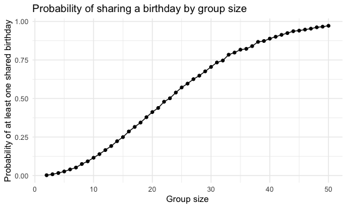
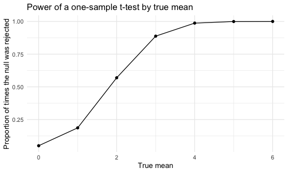
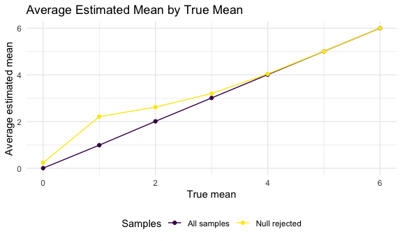

p8105_hw5_yc4959
================
Yimeng Cao
2026-11-11

Setup

# Problem 1

### Create a birthday function

Write a function that, for a fixed group size, randomly draws
“birthdays” for each person

``` r
birthday_check = function(n) {
  birthdays = sample(1:365, size = n, replace = TRUE)

  n_distinct(birthdays) < n
}
```

### Test the function

duplicate birthdays in the group; and returns TRUE or FALSE based on the
result.

``` r
set.seed(1)
birthday_check(7)
```

    ## [1] FALSE

``` r
birthday_check(77)
```

    ## [1] TRUE

``` r
birthday_check(245)
```

    ## [1] TRUE

### Run the simulations

Next, run this function 10000 times for each group size between 2 and
50.

``` r
set.seed(1)

birthday_results = 
  expand_grid(
    group_size = 2:50,
    iter = 1:10000
  ) |> 
  mutate(shared_birthday = map_lgl(group_size, birthday_check))
```

### Calculate the probabilities

compute the probability that at least two people in the group will share
a birthday by averaging across the 10000 simulation runs.

``` r
birthday_summary = 
  birthday_results |> 
  group_by(group_size) |> 
  summarize(probability = mean(shared_birthday))
birthday_summary
```

    ## # A tibble: 49 × 2
    ##    group_size probability
    ##         <int>       <dbl>
    ##  1          2      0.0024
    ##  2          3      0.0085
    ##  3          4      0.0167
    ##  4          5      0.0267
    ##  5          6      0.0399
    ##  6          7      0.0521
    ##  7          8      0.0751
    ##  8          9      0.0925
    ##  9         10      0.116 
    ## 10         11      0.139 
    ## # ℹ 39 more rows

### Plot the results

Make a plot showing the probability as a function of group size, and
comment on your results.

``` r
birthday_summary |> 
  ggplot(aes(x = group_size, y = probability)) + 
  geom_line() + 
  geom_point() + 
  labs(
    title = "Probability of sharing a birthday by group size",
    x = "Group size",
    y = "Probability of at least one shared birthday"
  )
```



TThe chance of a shared birthday increases pretty quickly as the group
gets bigger. It first passes 50% at a group size of 23. By the time
there are 50 people, the probability reaches 0.97. This is surprising
because even a small group can have many possible pairs of people,
making a shared birthday more likely.

## Problem 2

## Problem 3

### Create a simulation function

First, I created a function to simulates a dataset.

``` r
sim_t_test = function(mu, n = 30, sigma = 5) {
  sim_data = tibble(
    x = rnorm(n, mean = mu, sd = sigma)
  )
  t.test(pull(sim_data, x), mu = 0) |> 
    broom::tidy() |> 
    select(estimate, p.value)
}
```

### Test the function

``` r
sim_t_test(mu = 0)
```

    ## # A tibble: 1 × 2
    ##   estimate p.value
    ##      <dbl>   <dbl>
    ## 1    -1.62  0.0545

``` r
sim_t_test(mu = 4)
```

    ## # A tibble: 1 × 2
    ##   estimate  p.value
    ##      <dbl>    <dbl>
    ## 1     3.46 0.000962

### Run the simulations

I generated 5000 datasets for each true mean from 0 to 6

``` r
sim_results_df = 
  expand_grid(
    mu = 0:6,
    iter = 1:5000
  ) |> 
  mutate(estimate_df = map(mu, sim_t_test)) |> 
  unnest(estimate_df)
```

### Calculate power

I calculated power as the proportion of tests with a p-value below 0.05
for each true mean.

``` r
power_df = 
  sim_results_df |> 
  group_by(mu) |> 
  summarize(power = mean(p.value < 0.05))
power_df 
```

    ## # A tibble: 7 × 2
    ##      mu power
    ##   <int> <dbl>
    ## 1     0 0.05 
    ## 2     1 0.187
    ## 3     2 0.569
    ## 4     3 0.887
    ## 5     4 0.987
    ## 6     5 0.999
    ## 7     6 1

### Plot power

``` r
power_df |> 
  ggplot(aes(x = mu, y = power)) + 
  geom_line() + 
  geom_point() + 
  labs(
    title = "Power of a one-sample t-test by true mean",
    x = "True mean",
    y = "Proportion of times the null was rejected"
  )
```



As the true mean increases, the power also increases. This is because a
larger effect size makes it easier to reject the null hypothesis. When
mu = 0, the rejection rate is around 5%, while for larger values of mu,
the power approaches 1.

### Average estimates from all samples

``` r
all_results =
  sim_results_df |>
  group_by(mu) |>
  summarize(mean_estimate = mean(estimate)) |>
  mutate(group = "All samples")
all_results
```

    ## # A tibble: 7 × 3
    ##      mu mean_estimate group      
    ##   <int>         <dbl> <chr>      
    ## 1     0       0.00589 All samples
    ## 2     1       0.991   All samples
    ## 3     2       2.01    All samples
    ## 4     3       3.01    All samples
    ## 5     4       4.01    All samples
    ## 6     5       5.01    All samples
    ## 7     6       6.00    All samples

### Average estimates from rejected tests

``` r
rejected_results =
  sim_results_df |>
  filter(p.value < 0.05) |>
  group_by(mu) |>
  summarize(mean_estimate = mean(estimate)) |>
  mutate(group = "Null rejected")
rejected_results
```

    ## # A tibble: 7 × 3
    ##      mu mean_estimate group        
    ##   <int>         <dbl> <chr>        
    ## 1     0         0.236 Null rejected
    ## 2     1         2.21  Null rejected
    ## 3     2         2.62  Null rejected
    ## 4     3         3.20  Null rejected
    ## 5     4         4.04  Null rejected
    ## 6     5         5.01  Null rejected
    ## 7     6         6.00  Null rejected

The average estimates from all samples are generally close to the true
values of mu.

### Plot the average estimates

``` r
bind_rows(all_results, rejected_results) |>
  ggplot(aes(x = mu, y = mean_estimate, color = group)) +
  geom_line() +
  geom_point() +
  labs(
    title = "Average Estimated Mean by True Mean",
    x = "True mean",
    y = "Average estimated mean",
    color = "Samples"
  )
```



The average estimates from rejected tests are not always close to the
true values, especially when the true mean is small. That makes sense
because samples that happen to show larger effects are more likely to
reject the null hypothesis. When the true mean is large, nearly all
tests reject the null, so the average estimates are close to the true
values.
